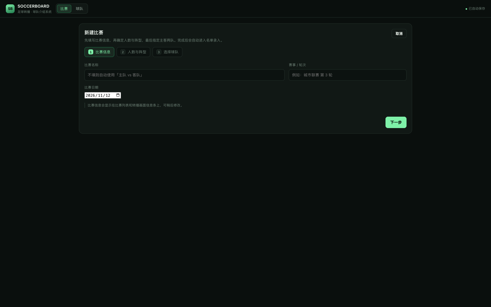
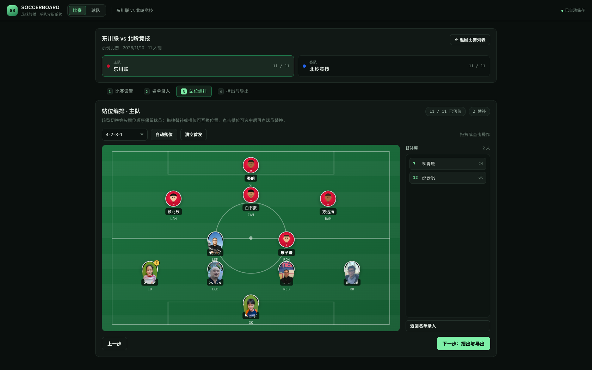
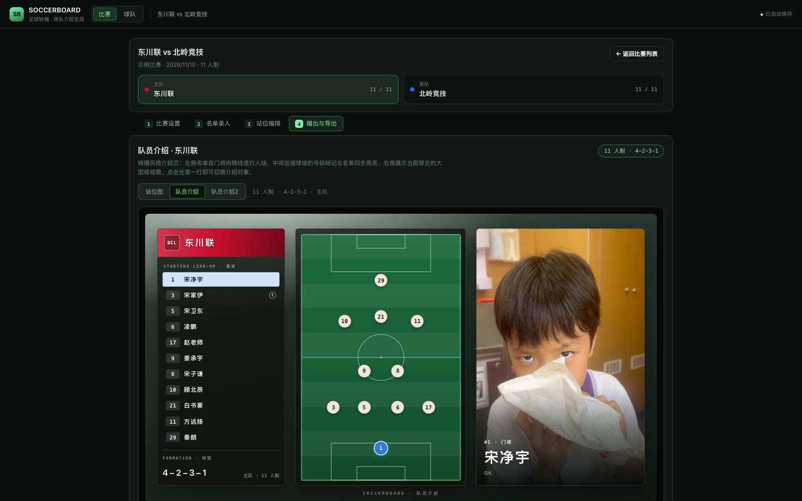
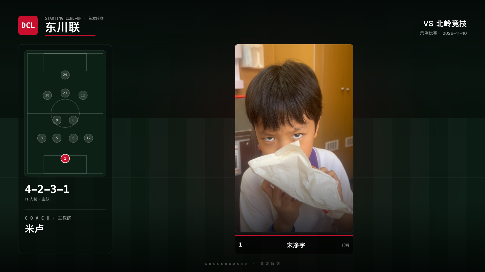

# SOCCERBOARD

面向足球转播画面的制作工具：管理球队与球员资料、编排比赛名单与站位，并一键输出播出站位图、球员介绍画面与视频。

前端使用 Vue 3 + Vite + TypeScript，后端使用 FastAPI + SQLite，所有数据与照片、视频均保存在本地。

## 功能

### 比赛管理

- 多场比赛列表：显示赛事、日期、队伍与完成状态
- 三步向导新建比赛：比赛信息 → 人数与阵型 → 选择主客队




### 名单录入

- 球队库三栏拖拽：从「球员库」拖到「首发」或「替补」，也可点击后再点位置放置
- 支持 5 / 7 / 9 / 11 人制与多种阵型，自动填位、清空重排
- 主队与客队分别录入，实时显示已选人数与缺位提示


### 站位编排

- 在球场上自由拖动球员调整站位，替补席可随时换上换下
- 阵营、号码、姓名、队长标记与头像同屏显示



### 播出与导出

#### 播出站位图

1920 × 1440 竖版画面，可切换横版 16:9 / 竖版 9:16，支持显示头像与姓名，并可直接导出 PNG 或录制 MP4 / WebM 播放动画。


#### 队员介绍

逐名展示首发球员：左侧名单随选中项高亮，中间球场同步点亮位置，右侧放大展示球员头像或视频。



#### 队员介绍2

1920 × 1080 横版合影介绍页：

- 按「守门员 → 后卫 → 中场 → 前场」自动分组，组内人数随阵型变化
- 支持「上一组 / 下一组 / 逐组演示」，切换时 0.8 秒淡入淡出
- 球员有视频时播放视频，播完停在最后一帧；无视频时显示照片
- 可在当前组内微调顺序，一键导出 PNG 或整段视频（组间自动淡化）




### 球队库

- 维护球队名称、三字代码、主教练与球队主色
- 球员档案：号码、姓名、位置、队长标记、照片（2:3 裁切）与视频（可裁切画面、截取片段）


## 快速开始

环境要求：Node.js 18+、Python 3.10+。

### 1. 后端

```bash
python3 -m venv server/.venv
server/.venv/bin/pip install -r server/requirements.txt
server/.venv/bin/python -m uvicorn server.main:app --host 127.0.0.1 --port 8010
```

### 2. 前端

```bash
cd app
npm install
npm run dev
```

打开 http://localhost:5173（前端已把 `/api` 代理到 8010）。

### 构建

```bash
cd app
npm run build
```

## 项目结构

```
SOCCERBOARD/
├── app/                    # 前端（Vue 3 + Vite + TS）
│   └── src/
│       ├── components/     # 步骤页、裁切弹窗、播出页面
│       ├── core/           # 类型、持久化、校验、工具
│       ├── render/         # Canvas 绘制（站位图、介绍页、视频合成）
│       ├── stores/         # 全局状态
│       └── views/          # 比赛列表、球队管理、新建向导
├── server/                 # 后端（FastAPI + SQLite）
│   ├── main.py             # API 路由
│   └── db.py               # 数据库结构与读写
└── docs/screenshots/       # README 截图
```

## 数据存储

- 数据库：`server/data/soccerboard.db`
- 球员照片：`server/data/media/photos/{球队ID}/{球员ID}.{ext}`
- 球员视频：`server/data/media/videos/{球队ID}/{球员ID}.{ext}`

以上目录已在 `.gitignore` 中排除，不会随仓库提交。
