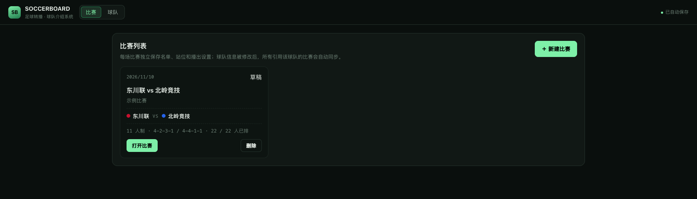
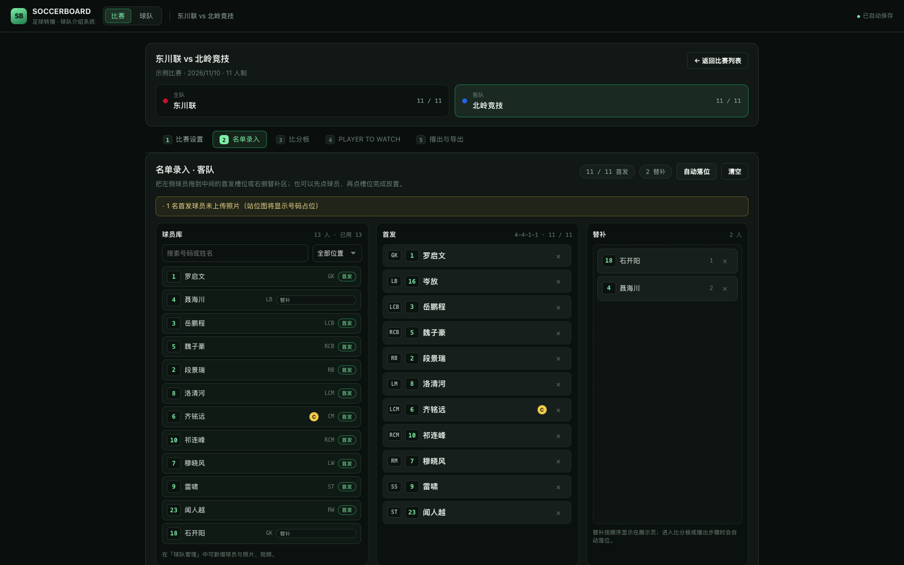
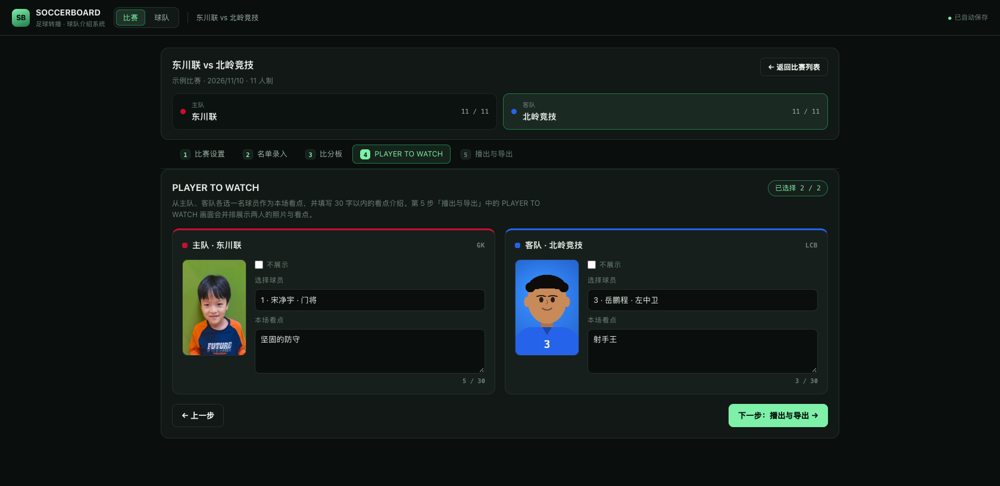
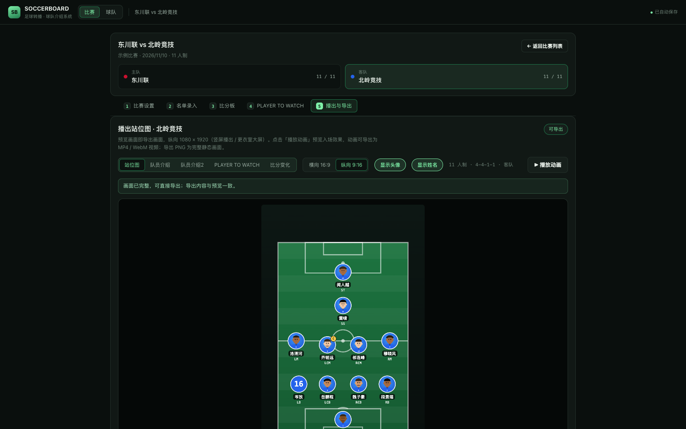
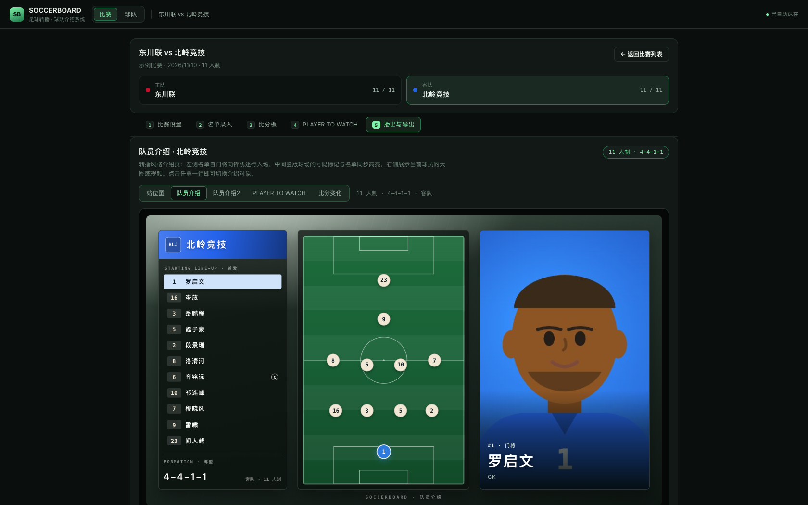
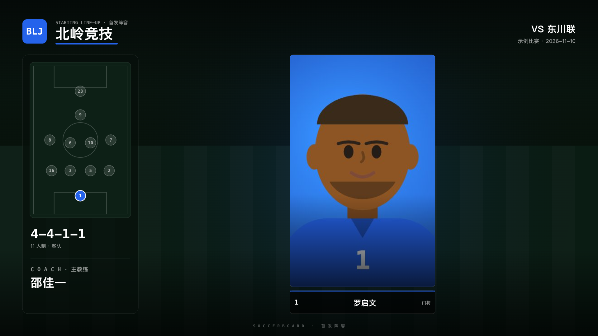
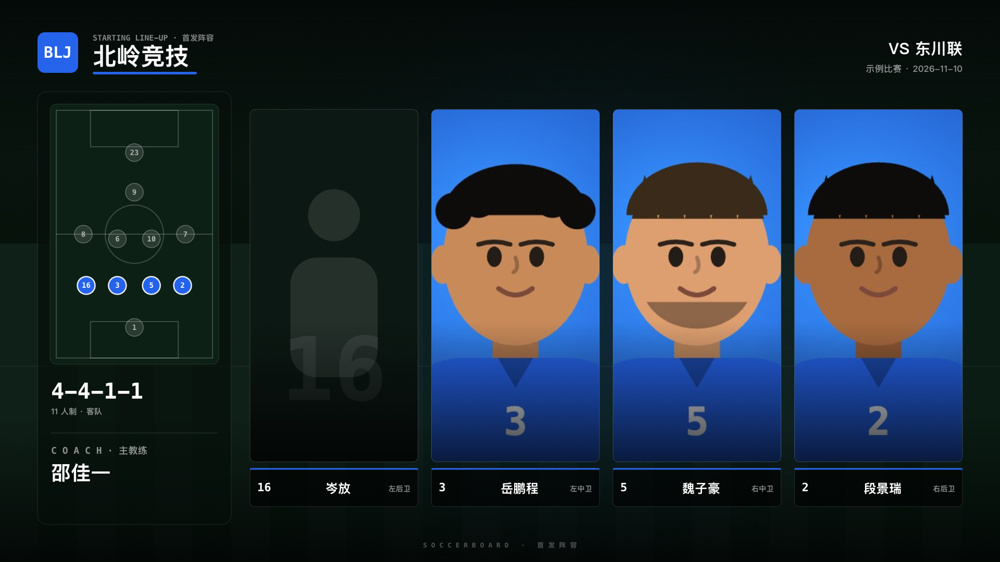
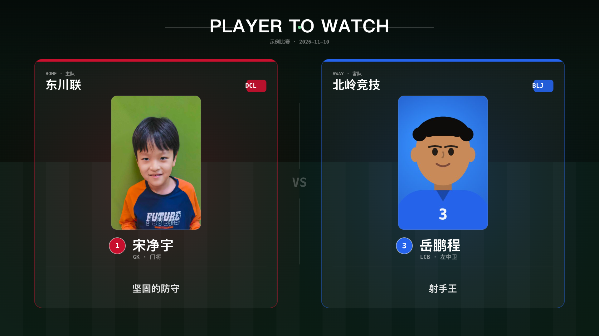
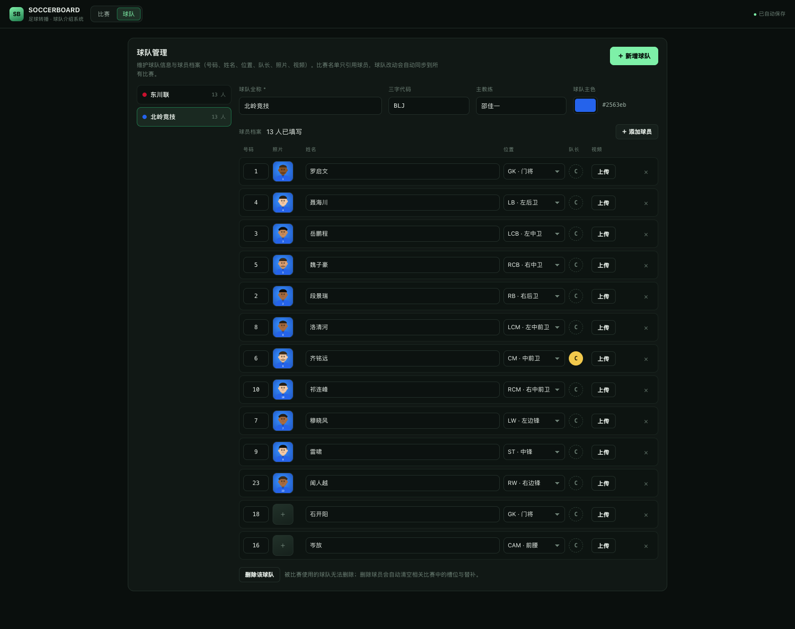

# SOCCERBOARD

面向足球转播画面的制作工具：管理球队与球员资料、录入比赛名单、记录比分变化，并一键输出播出站位图、球员介绍画面、比分变化视频等转播素材。

前端使用 Vue 3 + Vite + TypeScript，后端使用 FastAPI + SQLite，所有数据与照片、视频均保存在本地。

## 流程

1 比赛设置 → 2 名单录入 → 3 比分板 → 4 PLAYER TO WATCH → 5 播出与导出

名单录入完成后进入后续步骤时会自动按位置落位，无需手动拖拽排位。

每个功能的详细操作说明见 [USERGUIDE.md](USERGUIDE.md)。

## 功能

### 比赛管理

- 多场比赛列表：显示赛事、日期、队伍与完成状态
- 三步向导新建比赛：比赛信息 → 人数与阵型 → 选择主客队




### 名单录入

- 球队库三栏拖拽：从「球员库」拖到「首发」或「替补」，也可点击后再点位置放置
- 支持 5 / 7 / 9 / 11 人制与多种阵型，一键自动落位、清空重排
- 主队与客队分别录入，实时显示已选人数与缺位提示



### 比分板

- 1920 × 220 实底比分配置条：顶部小字通栏 + 主客队色带 + 中间比分，整块铺满画布，导出画面不依赖透明通道
- 顶部小字可自定义（60 字以内），留空则不显示
- 队名支持三种显示方式：英文缩写 / 完整队名 / 自定义名称
- 「记录本次比分」生成一条比分变化记录，支持撤销上一条、清空与导出记录 CSV
- 比分变化视频请在「播出与导出 → 比分变化」中播放或导出

### PLAYER TO WATCH

- 从主队、客队各选一名球员作为本场看点，本场首发与替补均可选
- 每名球员可填写 30 字以内的看点介绍，随比赛自动保存
- 可勾选「不展示」排除某一队：只展示一队时画面自动居中，两队都不展示时给出提示
- 并排预览双方选定球员的照片，未选时给出占位提示
- 播出页可直接播放预览与导出 PNG / 视频



### 播出与导出

播出页包含五个标签：站位图 / 队员介绍 / 队员介绍2 / PLAYER TO WATCH / 比分变化，均可预览并导出。

#### 播出站位图

1920 × 1440 竖版画面，可切换横版 16:9 / 竖版 9:16，支持显示头像与姓名，并可直接导出 PNG 或录制 MP4 / WebM 播放动画。



#### 队员介绍

逐名展示首发球员：左侧名单随选中项高亮，中间球场同步点亮位置，右侧放大展示球员头像或视频。



#### 队员介绍2

1920 × 1080 横版合影介绍页：

- 按「守门员 → 后卫 → 中场 → 前场」自动分组，组内人数随阵型变化
- 支持「上一组 / 下一组 / 逐组演示」，切换时 0.8 秒淡入淡出
- 球员有视频时播放视频，播完停在最后一帧；无视频时显示照片
- 可在当前组内微调顺序，一键导出 PNG 或整段视频（组间自动淡化）





#### PLAYER TO WATCH

1920 × 1080 横版双人看点画面：左右并排展示主客队各一名球员的照片、号码、姓名与位置，照片下方为各自的本场看点介绍。可点「播放」预览 8 秒淡入淡出动画，也可导出 PNG 或视频。



#### 比分变化

按第 3 步「比分板」记录的顺序逐条播放比分变化，每条展示 2.2 秒：

- 得分方队色带高亮，比分数字回弹
- 首条入场滑入，整段结尾淡出
- 可导出整段视频（1920 × 220，优先 WebM），文件名带比赛名

### 球队库

- 维护球队名称、三字代码、主教练与球队主色
- 球员档案：号码、姓名、位置、队长标记、照片（2:3 裁切）与视频（可裁切画面、截取片段）



## 快速开始

环境要求：Node.js 18+、Python 3.10+。

### 1. 后端

```bash
python3 -m venv server/.venv
server/.venv/bin/pip install -r server/requirements.txt
server/.venv/bin/python -m uvicorn server.main:app --host 127.0.0.1 --port 8010
```

### 2. 前端

```bash
cd app
npm install
npm run dev
```

打开 http://localhost:5173（前端已把 `/api` 代理到 8010）。

### 构建

```bash
cd app
npm run build
```

## macOS 桌面版

Electron 外壳 + 打包成可执行文件的后端（PyInstaller），双击即可运行，不依赖系统 Python。

```bash
desktop/build.sh
```

构建产物为 `desktop/out/mac-arm64/SOCCERBOARD.app`，复制到 `/Applications` 后可从启动台打开。App 启动时会自动拉起内置后端（127.0.0.1:8123）并加载界面，退出时一并关闭。

桌面版数据存放在 `~/Library/Application Support/soccerboard-desktop/data/`：首次启动会把构建时的种子数据复制过去，之后所有修改都保存在这里。

## 项目结构

```
SOCCERBOARD/
├── app/                    # 前端（Vue 3 + Vite + TS）
│   └── src/
│       ├── components/     # 步骤页、裁切弹窗、播出页面
│       ├── core/           # 类型、持久化、校验、工具
│       ├── render/         # Canvas 绘制（站位图、介绍页、视频合成）
│       ├── stores/         # 全局状态
│       └── views/          # 比赛列表、球队管理、新建向导
├── desktop/                # macOS 桌面版（Electron + PyInstaller）
│   ├── main.js             # Electron 主进程：拉起后端、打开窗口
│   ├── backend_entry.py    # 后端可执行文件入口
│   └── build.sh            # 一键构建 .app
├── server/                 # 后端（FastAPI + SQLite）
│   ├── main.py             # API 路由
│   └── db.py               # 数据库结构与读写
└── docs/screenshots/       # README 截图
```

## 数据存储

- 数据库：`server/data/soccerboard.db`
- 球员照片：`server/data/media/photos/{球队ID}/{球员ID}.{ext}`
- 球员视频：`server/data/media/videos/{球队ID}/{球员ID}.{ext}`

以上目录已在 `.gitignore` 中排除，不会随仓库提交。
