# SOCCERBOARD 使用指南

本指南按实际操作顺序，介绍 SOCCERBOARD 中每一个功能的用法。所有截图均来自真实运行界面。

## 目录

1. [界面与导航](#1-界面与导航)
2. [新建比赛](#2-新建比赛)
3. [第 1 步 比赛设置](#3-第-1-步-比赛设置)
4. [第 2 步 名单录入](#4-第-2-步-名单录入)
5. [第 3 步 比分板](#5-第-3-步-比分板)
6. [第 4 步 PLAYER TO WATCH](#6-第-4-步-player-to-watch)
7. [第 5 步 播出与导出](#7-第-5-步-播出与导出)
8. [球队管理](#8-球队管理)
9. [导出文件与数据保存](#9-导出文件与数据保存)
10. [常见问题](#10-常见问题)

---

## 1. 界面与导航

顶部导航只有两个入口：

- **比赛**：比赛列表，进入某场比赛后按 1 → 5 的步骤完成制作
- **球队**：球队与球员档案，比赛名单从这里取人

右上角显示本地服务连接状态，所有修改都会自动保存，无需手动点保存。

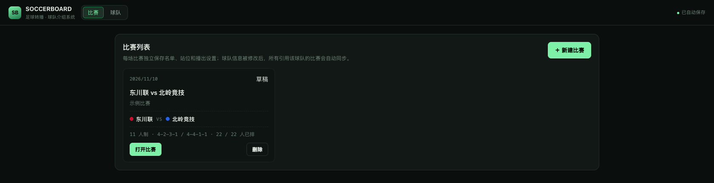

比赛列表中的每张卡片显示对阵双方、日期与人数，操作按钮：

- **打开比赛**：进入该场比赛的 5 步流程
- **删除**：删除整场比赛（不可恢复，谨慎使用）

点击「＋ 新建比赛」开始创建新比赛。

---

## 2. 新建比赛

新建比赛是一个三步向导，随时可以点「取消」放弃创建。

### 2.1 第 1 步：填写比赛信息

1. **比赛名称**：留空会自动使用「主队 vs 客队」
2. **赛事 / 轮次**：例如「城市联赛 第 3 轮」
3. **比赛日期**：默认今天，用于比赛列表与转播画面上的日期信息
4. 点「下一步」

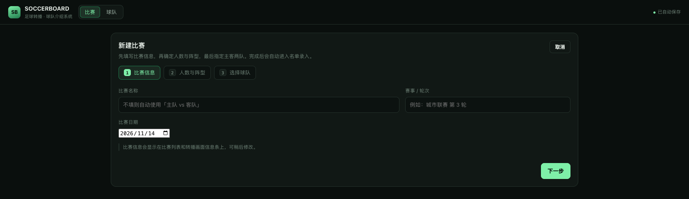

### 2.2 第 2 步：人数与阵型

1. **场上人数**：可选 5 / 6 / 8 / 11 人制，每种人数对应不同套阵型
2. **主队默认阵型**、**客队默认阵型**：进入名单后仍可单独修改
3. 点「下一步」

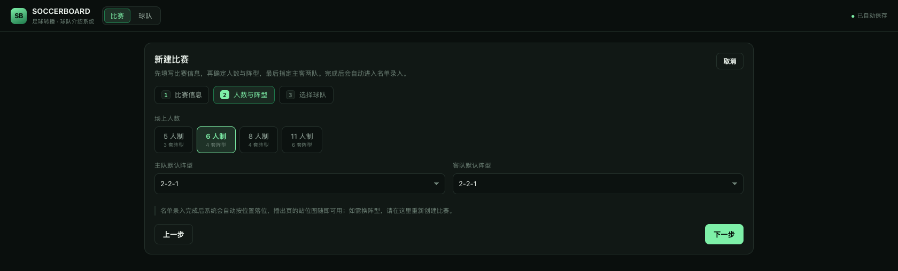

### 2.3 第 3 步：选择球队

1. **主队**、**客队**各选择一个已有球队（下拉里会显示球队人数）
2. 点「创建并进入名单」

创建完成后自动进入第 2 步名单录入。球队资料不足时，可先到顶部「球队」页补充。

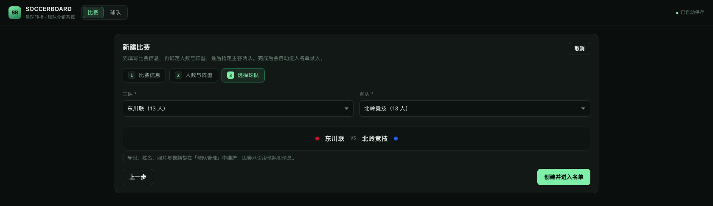

---

## 3. 第 1 步 比赛设置

进入比赛后，页面顶部是球队切换卡片（主队 / 客队，显示已选人数），下方是 5 步导航。

「比赛与人数设置」页可以随时修改：

1. **比赛名称 / 赛事 / 比赛日期**：改动立即生效，并同步到比赛列表与转播画面
2. **场上人数**：切换 5 / 6 / 8 / 11 人制，阵型选项随之变化
3. **主队阵型、客队阵型**：分别选择，例如 4-4-2、4-2-3-1、3-5-2
4. **本场球队**：需要补充球员资料时点「前往球队管理」
5. 完成设置后点「下一步：名单录入」

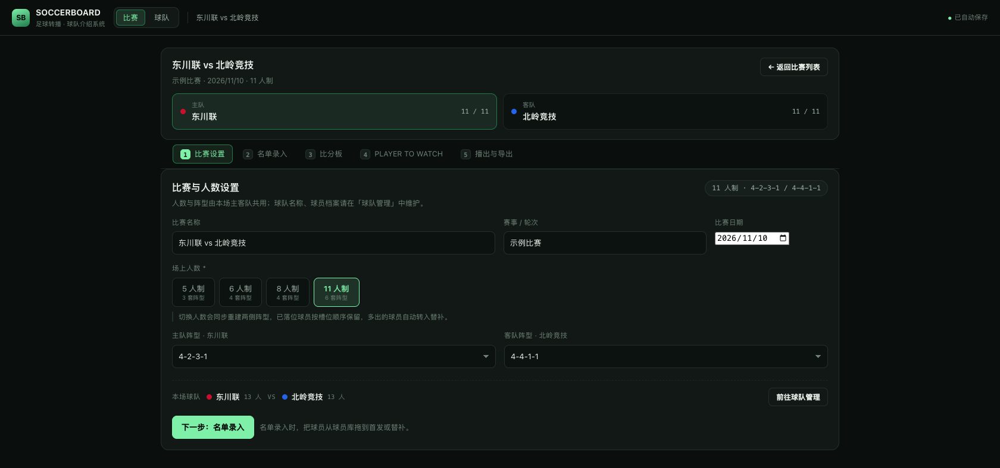

提示：

- 主队、客队卡片上的「11 / 11」表示已选人数 / 需要人数，点卡片可切换当前操作的球队
- 切换球队只影响当前编辑对象，不影响比赛数据

---

## 4. 第 2 步 名单录入

名单录入分左右两块：左侧是球队球员库，中间是首发（场上位置），右侧是替补席。

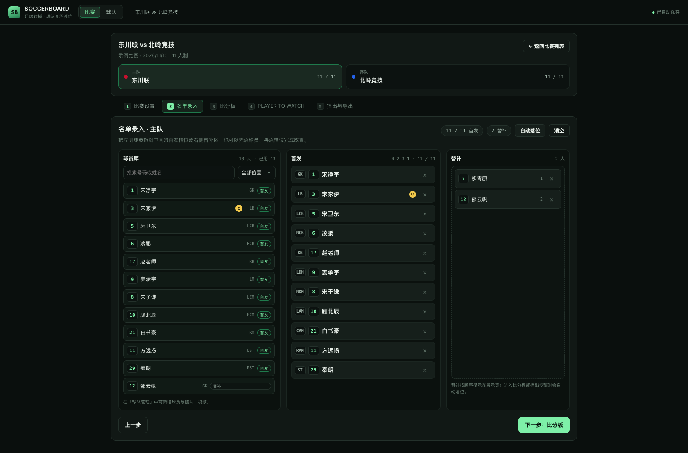

### 4.1 选择首发

有两种方式：

1. **拖拽**：把球员从球员库拖到首发区某个位置
2. **点击**：先点球员卡片，再点首发区的空位

球员卡片显示号码、姓名、位置，队长会有「C」标记。球员库顶部的搜索框可按号码或姓名筛选，右侧下拉可按位置筛选。

### 4.2 自动落位

点「自动落位」，系统按当前阵型把已选球员依次填入空位，适合快速铺满名单。之后仍可手动调整。

### 4.3 调整与清空

- 点首发位置上球员卡片的「×」可将其移出该位置
- 点「清空」清空当前球队的全部名单（只影响当前球队）
- 替补席球员可通过拖拽换上首发

### 4.4 完成名单

名单人数满足要求后，点「下一步：比分板」进入比分环节。人数不足时按钮会提示还需要多少人。

---

## 5. 第 3 步 比分板

比分板用于生成 1920 × 220 的转播比分配置条，并记录比赛中的每一次比分变化。

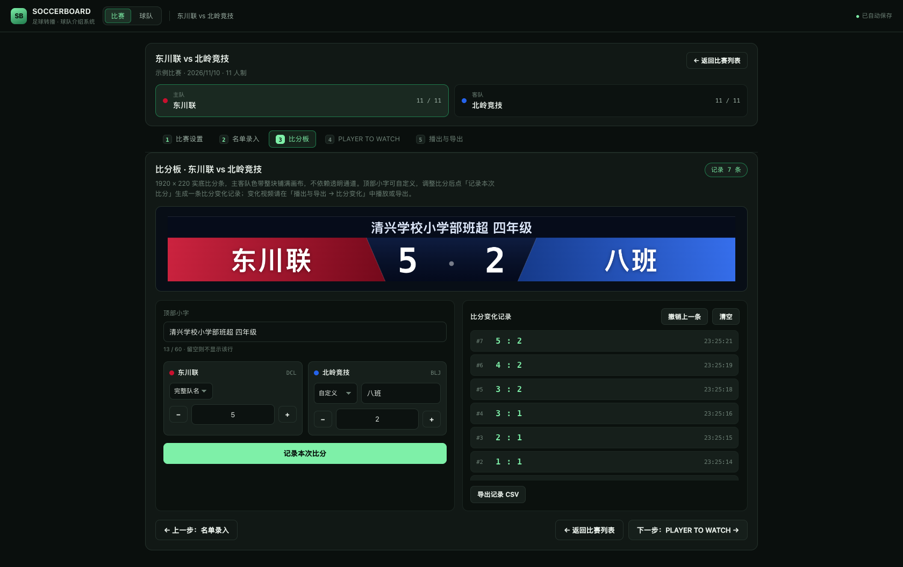

### 5.1 顶部小字

在「顶部小字」输入框中填写赛事信息（最多 60 字），例如「城市联赛 · 第 3 轮」「FIFA WORLD CUP 2018 · GROUP B」。留空则不显示这一行。

画面结构：顶部小字通栏 + 主客队色带 + 中间比分，整块铺满画布，导出视频不需要透明通道。

### 5.2 队名显示方式

每支球队都有一个下拉，可选：

- **英文缩写**：使用球队的三字代码（如 DCL、BLJ）
- **完整队名**：使用球队全称
- **自定义**：手动填写显示名称（最多 20 字，留空时回退为缩写）

队名字号会自动适配色带宽度，过长时自动缩小。

### 5.3 设置比分

用「−」「+」按钮调整，也可直接在数字框中输入（0–99）。主客队分别设置。

### 5.4 记录比分变化

1. 先把比分调整为当前比分
2. 点「记录本次比分」，生成一条记录（右侧列表按时间倒序显示）
3. 重复以上步骤记录每一次进球

注意：

- 与上一条记录完全相同（比分未变）时不会重复新增
- 点「撤销上一条」可删除最近一条记录
- 点「清空」删除全部记录（不可恢复）
- 点「导出记录 CSV」可导出全部记录（含时间）

比分变化视频不在本页导出，请到「播出与导出 → 比分变化」播放或导出。

---

## 6. 第 4 步 PLAYER TO WATCH

从主队、客队各选一名球员作为本场看点，用于第 5 步的双人看点画面。

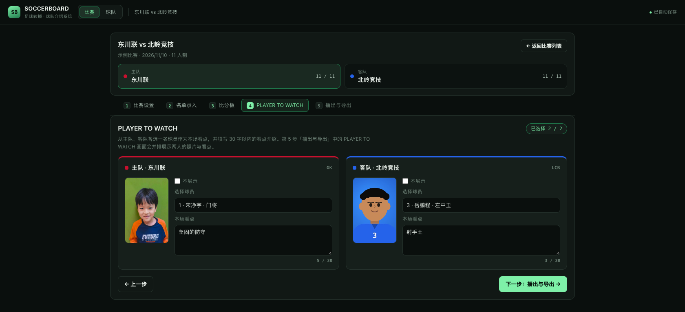

操作：

1. 在「选择球员」下拉中选择该队球员（列表显示号码 · 姓名 · 位置）
2. 在「本场看点」填写介绍（最多 30 字），例如「本赛季已打进 8 球，定位球主罚手」
3. 勾选「不展示」可在播出画面中隐藏该侧
4. 左右两侧分别设置，右上角显示「已选择 2 / 2」
5. 完成后点「下一步：播出与导出」

---

## 7. 第 5 步 播出与导出

播出页顶部标签依次为：站位图 / 队员介绍 / 队员介绍2 / PLAYER TO WATCH / 比分变化。所有画面都按当前选中的球队（主队或客队）生成，切换顶部球队卡片即可切换素材。

### 7.1 站位图

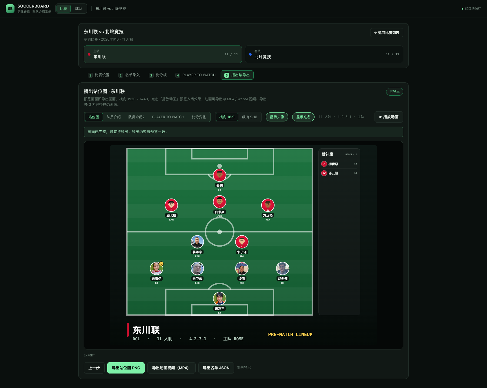

1. **横向 16:9 / 纵向 9:16**：切换画幅，纵向为 1080 × 1920，适合竖屏播出或更衣室大屏
2. **显示头像 / 显示姓名**：控制画面上的球员头像与姓名
3. **▶ 播放动画**：预览入场动画（球员按门将 → 后卫 → 中场 → 前锋依次入场），双击画面也可重播
4. **导出站位图 PNG**：导出完整静态画面
5. **导出动画视频**：把入场动画录制成视频（MP4 或 WebM，取决于浏览器支持），录制期间请停留在本页
6. **导出名单 JSON**：导出本场名单数据
7. 右下角显示最近一次导出时间

名单不完整（有位置未安排球员）时，导出按钮不可用，状态行会说明原因。

### 7.2 队员介绍

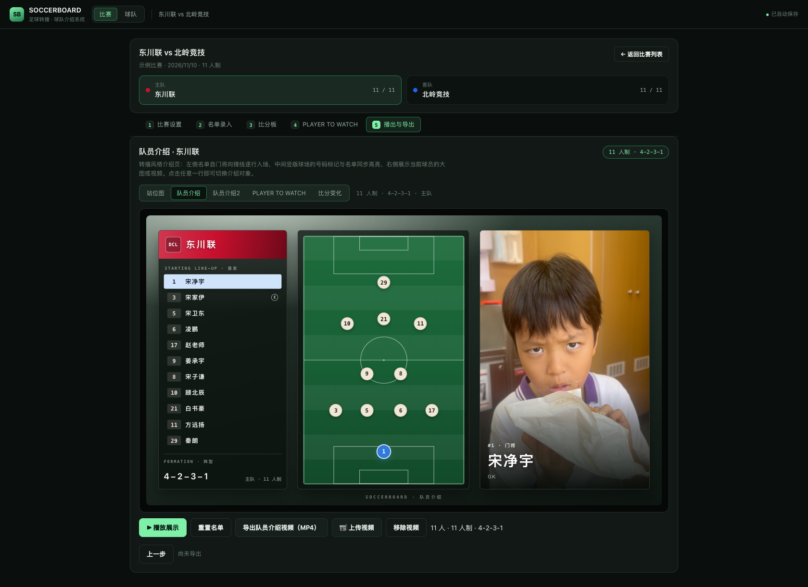

1. 左侧名单自门将向锋线逐行入场，中间竖版球场号码标记与名单同步高亮，右侧展示当前球员大图或视频
2. **点击任意一行**即可切换当前介绍的球员，画面会重新播放该球员的入场
3. **▶ 播放展示**：从头播放一遍完整介绍
4. **重置名单**：恢复到默认从第一名开始
5. **导出队员介绍视频**：导出整段介绍视频
6. **📹 上传视频**：为当前球员上传一段介绍视频，画面右侧会优先播放视频
7. **移除视频**：删除当前球员已上传的视频

### 7.3 队员介绍2

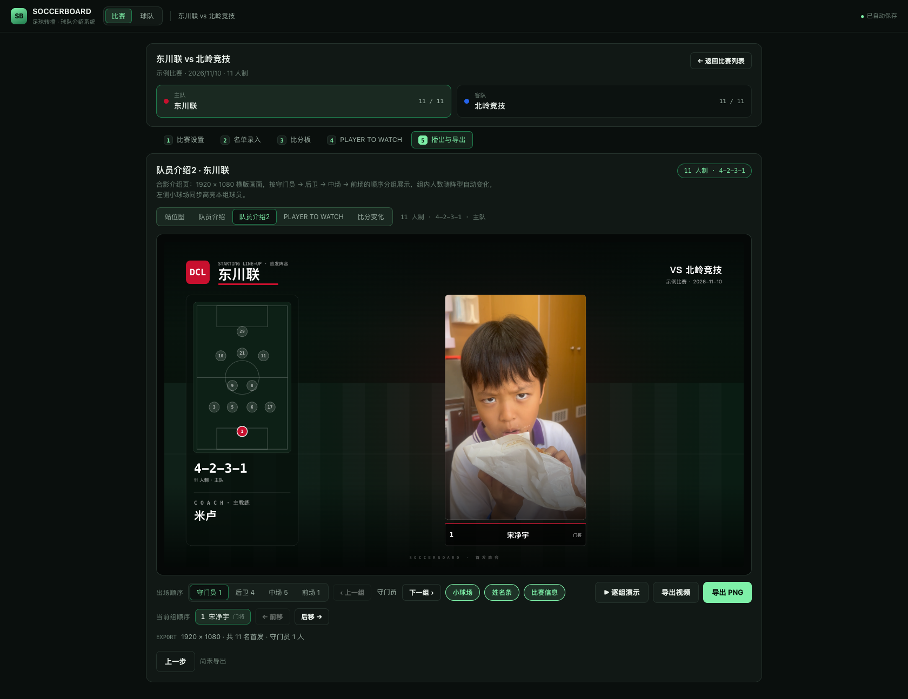

1920 × 1080 横版合影介绍，按守门员 → 后卫 → 中场 → 前场分组展示。

1. **出场顺序按钮**（守门员 / 后卫 / 中场 / 前场，带人数）：直接跳到某一组
2. **‹ 上一组 / 下一组 ›**：逐组切换
3. **小球场**：显示或隐藏左侧球场示意，组内球员同步高亮
4. **姓名条 / 比赛信息**：控制画面上的姓名条与比赛信息
5. **▶ 逐组演示**：按顺序播放所有分组
6. **导出视频 / 导出 PNG**：输出当前画面的视频或图片
7. **当前组顺序**：点选球员后，用「← 前移 / 后移 →」调整该球员在本组内的出场顺序

### 7.4 PLAYER TO WATCH

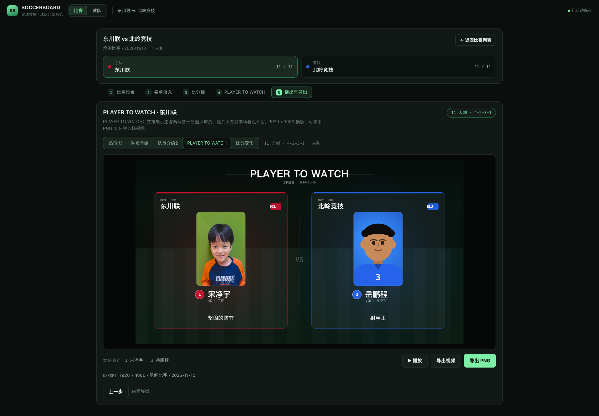

1. **▶ 播放**：预览 8 秒淡入淡出动画（播放中按钮变为「■ 停止」）
2. **导出视频**：输出整段视频
3. **导出 PNG**：输出静态画面

画面内容来自第 4 步的设置；某侧未选球员或勾选「不展示」时，该侧会留白或隐藏。

### 7.5 比分变化

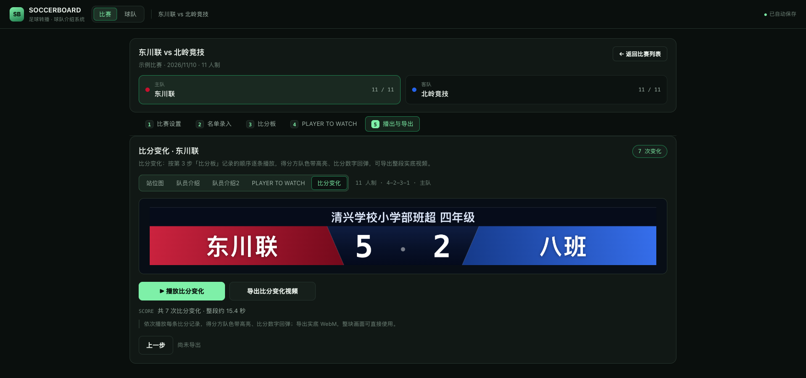

1. **▶ 播放比分变化**：按第 3 步记录的顺序逐条播放，每条 2.2 秒
   - 得分方队色带高亮，比分数字回弹
   - 首条入场滑入，整段结尾淡出
   - 播放中按钮变为「■ 停止」，可随时中断
2. **导出比分变化视频**：输出整段 1920 × 220 视频，文件名带比赛名

状态行显示当前播放到第几条与对应比分，例如「第 3 / 7 次变化 · 2 : 1」。还没有记录时，页面会提示先到第 3 步「比分板」记录比分。

---

## 8. 球队管理

顶部点「球队」进入，管理所有球队与球员档案。比赛名单只引用球员，球队资料的修改会自动同步到所有使用该球队的比赛。

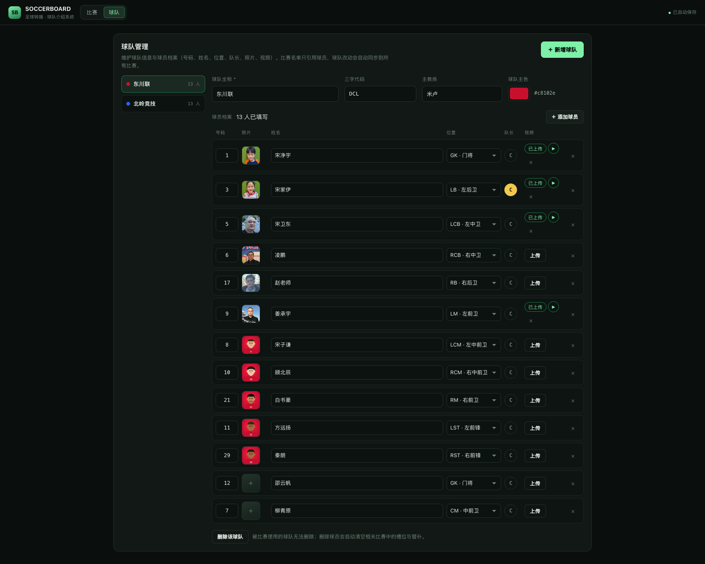

### 8.1 新增球队

1. 点「＋ 新增球队」
2. 填写 **球队全称**（必填）、**三字代码**（用于缩写显示）、**主教练**、**球队主色**（决定比分板、站位图等画面的队色）

### 8.2 球员档案

每位球员一行，从左到右依次为：

- **号码**：最多 2 位
- **照片**：点「＋」上传；已有照片时点击头像可预览并重新裁切
- **姓名**：最多 20 字
- **位置**：GK / LB / CB / CM / ST 等，决定名单中的位置与自动落位顺序
- **C**：设为队长（全队唯一）
- **视频**：点「上传」选择视频；已上传时显示「已上传」，可用「▶」预览、「×」移除
- **×**：删除该球员

点「＋ 添加球员」新增一行。球员资料的修改会立即保存并同步到比赛。

---

## 9. 导出文件与数据保存

### 9.1 自动保存

- 所有修改自动保存到本机 SQLite 数据库，无需手动保存
- 照片与视频以文件形式存放：`data/media/photos/{球队}/`、`data/media/videos/{球队}/`
- 数据库文件：`data/soccerboard.db`

### 9.2 导出内容

| 导出项 | 位置 | 说明 |
| --- | --- | --- |
| 站位图 PNG | 播出与导出 → 站位图 | 完整静态画面，1920 × 1440（横向）或 1080 × 1920（纵向） |
| 动画视频 | 播出与导出 → 站位图 | 入场动画，优先 MP4 |
| 名单 JSON | 播出与导出 → 站位图 | 本场名单数据 |
| 队员介绍视频 | 播出与导出 → 队员介绍 | 逐人介绍动画 |
| 队员介绍2 视频 / PNG | 播出与导出 → 队员介绍2 | 分组介绍画面 |
| PLAYER TO WATCH 视频 / PNG | 播出与导出 → PLAYER TO WATCH | 8 秒双人看点画面 |
| 比分变化视频 | 播出与导出 → 比分变化 | 1920 × 220，优先 WebM |
| 比分记录 CSV | 第 3 步 比分板 | 全部比分变化及时刻 |

导出的文件会保存到浏览器默认下载目录。

---

## 10. 常见问题

**Q：导出按钮是灰的，不能点？**

站位图需要名单完整（每个位置都有球员）。状态行会提示还缺几人；到第 2 步补全即可。

**Q：为什么比分变化没有内容？**

比分变化完全来自第 3 步「比分板」的记录。先调整比分并点「记录本次比分」，再回到播出页播放或导出。

**Q：录制的视频没有透明背景？**

比分板采用整块实底设计，画面本身就是完整背景，不依赖透明通道。若浏览器不支持 WebM，视频会输出为 MP4。

**Q：自定义队名没生效？**

自定义方式下若输入为空，会自动回退为英文缩写；检查下拉是否选在「自定义」，并填写显示名称。

**Q：换了球队资料，比赛会变吗？**

会。比赛只引用球员，球队的姓名、号码、位置、照片修改会同步到所有相关比赛。

**Q：录制视频时能切换页面吗？**

不能。视频录制依赖当前页面持续绘制画面，录制期间请停留在当前标签页，直到提示完成。
